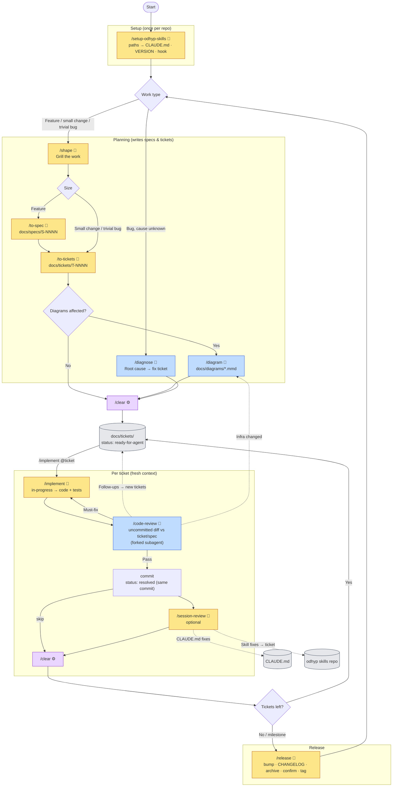
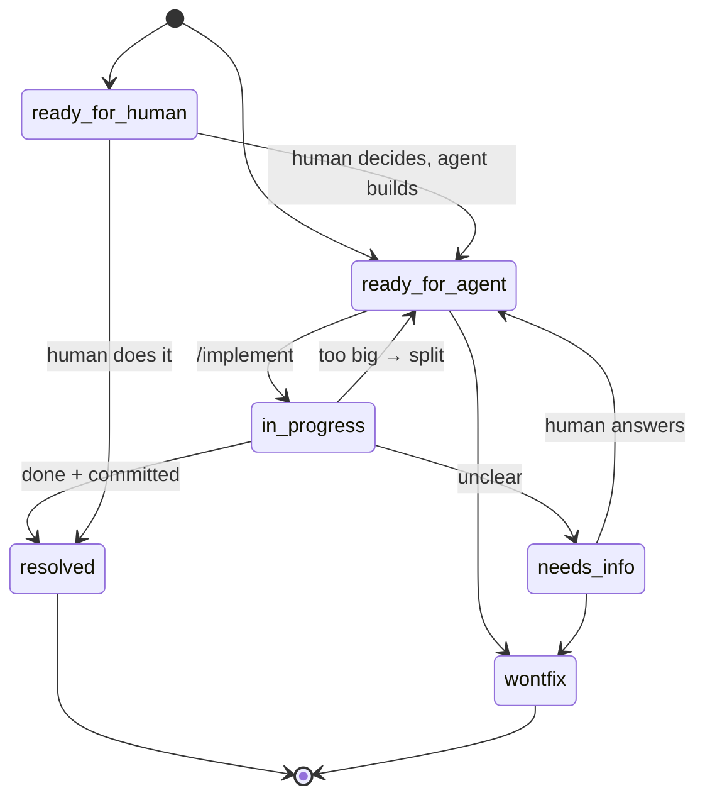

# odhyp skills — Handoff

## Goal

Build my own agent-skills repo, **`odhyp`**. I install it in Claude Code as a plugin, and anyone else can install it with `npx skills add`. It encodes my engineering workflow so that no project starts from zero.

The workflow started from Matt Pocock's skills (github.com/mattpocock/skills) and was then simplified and reworked. Use his repo as a structural reference, but **don't copy its workflow**: this document is the spec.

**Core principle: tickets are the handoff between fresh contexts.** Planning, diagnosing and reviewing all *write* tickets. Only `implement` writes code. I run `/clear` between tickets, so every ticket must contain everything needed to implement it.

---

## 1. Repo layout

```
skills/
├── .claude-plugin/
│   ├── plugin.json          # the plugin
│   └── marketplace.json     # makes this repo its own marketplace
├── skills/
│   └── <skill-name>/SKILL.md (+ optional templates/, scripts/)
├── README.md                # install, workflow diagram, skill table
├── VERSION                  # this repo is versioned too: start at 0.1.0
└── CHANGELOG.md
```

- **Plugin name:** `odhyp`, so commands appear as `/odhyp:<skill>`.
- **Install (Claude Code):** `/plugin marketplace add odhyp/skills` then `/plugin install odhyp@odhyp`.
- **Install (other agents / editable copies):** `npx skills@latest add odhyp/skills`.
- **Versioning:** bump the version in **both** `plugin.json` and `marketplace.json` on every release, because clients only update when the version increases.
- Skills reference their own bundled files via `${CLAUDE_SKILL_DIR}`, never hard-coded paths. Nothing lives outside `skills/`, because `npx skills add` copies only skill folders.
- The ticket and spec formats live in `skills/setup-odhyp-skills/templates/`. Setup copies them into each project (§4), and every other skill reads the project's copy.
- This repo uses its own rules: Conventional Commits, SemVer, CHANGELOG.

**Verify before building:** check the current Claude Code docs for skill frontmatter (`name`, `description`, `disable-model-invocation`, `allowed-tools`, `argument-hint`, `context: fork`, `$ARGUMENTS`) and the plugin/marketplace JSON schemas. The fields above came from community guides, not the official pages.

---

## 2. Skills (10)

Plain, descriptive names. No theme.

| Skill | Invocation | Does |
|---|---|---|
| `setup-odhyp-skills` | Manual | Run once per repo. Sets up structure, CLAUDE.md block, VERSION, CHANGELOG, commit hook, test/lint commands. On an existing repo, also draws the initial diagrams. Optionally starts from one of my starters. |
| `shape` | Manual | Entry point for features, small changes and trivial bugs. Grills me until we agree, then names the next step. Writes nothing. |
| `to-spec` | Manual | Turns the agreed conversation into `docs/specs/NNNN-slug.md`. |
| `to-tickets` | Manual | Splits a spec, or an agreed small change with no spec, into self-contained tickets in `docs/tickets/`. |
| `diagnose` | Auto | Triggers when I report a bug whose cause is unknown. Never triggers on failures in work that's in progress. Reproduces the bug, finds the root cause, then writes a `fix` ticket. **Does not fix.** |
| `diagram` | Auto | Creates or updates `docs/diagrams/*.mmd`. Triggers only when a change adds, removes or rewires services, infrastructure, data flow or module boundaries. |
| `implement` | Manual | `/implement @docs/tickets/NNNN-slug.md`: builds one ticket test-first, runs `code-review`, then commits. The only skill that writes code. |
| `code-review` | Auto | Runs after `implement` finishes and **before it commits**, in a forked subagent (`context: fork`). Reviews the uncommitted diff against the ticket, or the spec, or the request. Returns must-fix findings to `implement` and writes follow-up tickets. |
| `release` | Manual | Computes the SemVer bump from resolved tickets and commits, updates VERSION and CHANGELOG, archives, and tags after I confirm. |
| `session-review` | Manual | Run before `/clear`. Reviews *this session* and suggests improvements to the agent's environment. |

**Invocation rule:**
- **Manual** (`disable-model-invocation: true`) for anything with side effects, or where I decide when it happens.
- **Auto** for procedures that should start when a condition is met. Auto skills **must** state their trigger condition precisely in `description`.
- Skills may chain only to **auto** skills. For example, `to-spec` may say "use the diagram skill", `implement` runs `code-review` before committing, and `release` runs `code-review` checks.

**Always-on rules go in CLAUDE.md, not in skills.** The commit format is the main example.

---

## 3. Workflow



👤 manual skill · 🤖 auto skill (I can also call it) · ⚙️ built-in Claude Code command, run by me

`/clear` is a built-in command that skills can't trigger, so I run it myself. `context: fork` for `implement` is a possible later upgrade, not for v0.1.

---

## 4. Target project structure (created by `setup-odhyp-skills`)

```
project/
├── CLAUDE.md
├── VERSION                 # 0.1.0
├── CHANGELOG.md
├── .githooks/commit-msg    # POSIX shell, no Node/Husky
└── docs/
    ├── TICKET-FORMAT.md    # copied by setup
    ├── SPEC-FORMAT.md      # copied by setup
    ├── specs/              # active specs, flat
    ├── tickets/            # active tickets, flat
    ├── diagrams/           # infrastructure.mmd · architecture.mmd · data-flow.mmd
    └── releases/
        └── vX.Y.Z/
            ├── RELEASE.md
            ├── specs/
            └── tickets/
```

**Rules:**
- **Flat.** No folders per feature or per status.
- **Two ID sequences per project**, one for tickets and one for specs, zero-padded: `T-0018`, `S-0005`. The next ID is the highest existing one of that kind (including `releases/`) plus one. File names are `NNNN-short-slug.md`. IDs are never reused.
- **Links use IDs, never paths**, so moving files into `releases/` breaks nothing.
- **Paths are configurable.** Skills read them from the CLAUDE.md block and never hard-code `docs/`, because some projects use `docs/` for a docs site. Setup asks me when there's a conflict.
- Diagrams are `.mmd` files (for Polaris), not `.md` with a Mermaid block, even though GitHub won't render them. Additional diagram files only when a project needs them.
- Projects may be Hugo, Python, Astro or anything else. **Skills must not assume Node.**

**CLAUDE.md block written by setup:**

```markdown
## odhyp skills
- Specs: docs/specs/ · Tickets: docs/tickets/ · Diagrams: docs/diagrams/
- Releases archive: docs/releases/
- Formats: docs/TICKET-FORMAT.md · docs/SPEC-FORMAT.md
- View diagrams: npx -y @odhyp/polaris@2
- Test: <command> · Lint: <command>      # asked during setup
- Commits: Conventional Commits, enforced by .githooks/commit-msg
  (activate per clone: git config core.hooksPath .githooks)
  Format: type(scope)!: subject — footer `Refs: T-NNNN`
- Versioning: SemVer, starts at 0.1.0. Bumps are computed by /release.
```

**commit-msg hook:** accept `^(feat|fix|perf|refactor|test|docs|build|ci|chore|style|revert)(\([a-z0-9-]+\))?!?: .+`, plus merge and revert commits git generates. Setup runs `git config core.hooksPath .githooks`. An optional CI check is a later addition.

---

## 5. Ticket format

Put this in one shared reference (`skills/setup-odhyp-skills/templates/TICKET-FORMAT.md`). Setup copies it into the project, and every skill that writes tickets points to the project's copy.

### Frontmatter

```yaml
---
id: T-0018
title: Dashboard layout
type: feat
breaking: false
scope: dashboard
status: ready-for-agent
spec: S-0005              # or none
depends_on: [T-0017]
source: to-tickets        # to-tickets | diagnose | code-review | implement | human
from: T-0015              # ticket this was split from / follows up, or none
diagrams: [architecture]  # diagrams this changes, or []
released_in:              # set by /release
---
```

- No dates (git has them), no assignee (status covers it), no priority (added later if needed).

### `type`: identical to commit types

| type | Semver | | type | Semver |
|---|---|---|---|---|
| `feat` | minor | | `test` | none |
| `fix` | patch | | `docs` | none |
| `perf` | patch | | `build` / `ci` | none |
| `refactor` | none | | `chore` | none |

`breaking: true` means a major bump, for any type. Before 1.0.0, a breaking change bumps the minor version.

### `status`

| status | Meaning | Set by |
|---|---|---|
| `ready-for-agent` | Fully specified, so an agent can do it | to-tickets, diagnose, code-review, me |
| `ready-for-human` | Needs a person (credentials, DNS, design call, manual test) | any skill, me |
| `needs-info` | Blocked on a question in `## Questions` | implement |
| `in-progress` | An agent is working on it (used for crash recovery) | implement |
| `resolved` | Code and tests committed | implement, in the same commit as the code |
| `wontfix` | Dropped (including duplicates), with the reason in `## Notes` | me |

Dependencies aren't a status: `implement` refuses to start until everything in `depends_on` is `resolved`.



### Body

```markdown
## Context
What and why, readable without the spec.

## Decisions that apply
Choices copied from the spec that this ticket must follow.

## Files
- path (new | change)

## Acceptance criteria
- [ ] …

## Out of scope
What NOT to build here.

## Questions
<!-- only when needs-info; human answers inline -->

## Notes
<!-- implement appends what it did; wontfix reason -->
```

`fix` tickets from `diagnose` add these after Context: `## Reproduction`, `## Expected / Actual`, `## Root cause`, `## Failing test to write first`. Trivial-bug `fix` tickets from `to-tickets` skip these sections, because the cause is already known; state it in one line in Context.

**Self-contained rule:** a fresh agent must be able to finish the ticket from the ticket alone. The spec link is background reading only. `to-tickets` copies whatever the ticket needs from the spec.

**Size rule:** one ticket fits one fresh session.

Include one complete `feat` example and one complete `fix` example in TICKET-FORMAT.md.

---

## 6. Spec format

```markdown
---
id: S-0005
title: Build dashboard
status: draft             # draft | accepted | done
tickets: [T-0018, T-0019]
---

## Problem
## Goals / Non-goals
## Design
## Diagrams affected
- architecture.mmd (new dashboard module)   # empty → diagram skill is skipped
## Decisions
<!-- added during implementation: date · ticket ID · what changed and why -->
```

A spec becomes `done` when all of its tickets are `resolved` or `wontfix`.

---

## 7. Skill behaviour details

### `shape`
Works like Matt's grilling skill: one question at a time, until we agree on the work. This applies to all work, including a one-line fix, so a small change can't skip thinking. Writes nothing. When we agree, it names the next step:
- **Feature** → `/to-spec`, then `/to-tickets`.
- **Small change / trivial bug** → `/to-tickets` with `spec: none` (usually one ticket).

A bug with an unknown cause skips `shape` and goes straight to `diagnose`. There's nothing to shape until the cause is known.

### `implement`
1. Read the ticket given via `@path`. Running it without an argument is an optional shortcut that picks the next eligible ticket: `in-progress` first, then the lowest-numbered `ready-for-agent` whose dependencies are resolved.
2. Refuse to start if the ticket is `resolved` or `wontfix`. If it's `needs-info`, show the questions. If dependencies aren't resolved, list them.
3. If it's `in-progress`, check `git status` and resume. Otherwise set it to `in-progress`.
4. Write tests first, implement, then run the test and lint commands from CLAUDE.md.
5. If `diagrams` isn't empty, update those diagrams following the diagram skill.
6. If the ticket proves the spec wrong, add an entry under the spec's `## Decisions`.
7. Run `code-review` on the uncommitted diff. Fix any must-fix findings, re-run the tests, and review again.
8. **Definition of done:** review passes, tests pass, lint is clean, acceptance criteria are checked off, Notes are appended, and `status: resolved`. Commit all of it together: `type(scope)!: subject` with the footer `Refs: T-NNNN`.
9. If the ticket is unclear, set `needs-info` with the questions and stop. If it's too big, split it into new tickets (`from:` pointing to this one) and stop. **Never guess.**

**Commits per ticket:** a ticket normally produces one commit. More are allowed when a bug turns up after that commit (for example, a later review or a must-fix sent back). Every commit for the ticket carries `Refs: T-NNNN`, so the ticket's history is `git log --grep "Refs: T-NNNN"`.

### `code-review`
- Runs inside `implement`'s flow, after the code and tests are written and **before the commit**. It reviews the working-tree diff against the ticket, or the spec, or the original request if there's neither.
- Runs with `context: fork`: a subagent that sees only the ticket (or spec/request) and the diff, not `implement`'s reasoning, so the review isn't biased by the implementer's assumptions. `implement` must pass the ticket ID or path when it calls the skill. Verify `context: fork` works for an auto skill called from another skill before relying on it.
- Check: correctness, tests, acceptance criteria, commit format, the definition of done, and whether diagrams are up to date.
- **Must-fix:** return the findings to `implement`, which fixes them before committing.
- **Must-fix found after the commit** (a review run later): set the ticket back to `ready-for-agent` and add the findings under Notes. The fix becomes an extra commit with the same `Refs:`.
- **Follow-ups:** write new tickets with `source: code-review` and `from: <this ticket>`.
- **Infrastructure or structure changed without a diagram update:** create a ticket, or trigger `diagram`.

### `diagnose`
Triggers when I report a bug whose cause is unknown. It must **not** trigger on test or lint failures inside an `implement` run; those are `implement`'s to fix. Reproduce the bug, find the root cause, and write a `fix` ticket with all the fix sections. It never edits code.

### `diagram`
Edit only the `.mmd` files under the diagrams path. Use stable file names. Each diagram gets a short header comment saying what it covers.

### `release`
1. Collect the `resolved` tickets since the last tag, plus the commits.
2. Compute the bump: major if anything is breaking (minor while the version is below 1.0), minor if any `feat`, patch if any `fix` or `perf`.
3. **Show me the proposed version and the CHANGELOG entry, and wait for my OK.** Nothing is written, committed or tagged before that.
4. Write VERSION, update `package.json` or `pyproject.toml` when present, update CHANGELOG.md (a short summary that links to the release folder), and set `released_in` on the tickets.
5. Move the resolved and wontfix tickets, and the `done` specs, into `docs/releases/vX.Y.Z/`, and write `RELEASE.md` there.
6. Commit with `chore(release): vX.Y.Z` and run `git tag vX.Y.Z`.

### `session-review`
Look back over the current session (it must run before `/clear`): retries, wrong assumptions, my corrections, missing context. Then:
- Suggest edits to the project's CLAUDE.md, and apply them only if I approve.
- Print improvements to the skills themselves as a ready-to-paste ticket for the **odhyp skills repo** (same ticket format). The installed plugin is read-only.
- It writes no other files.

### `setup-odhyp-skills`
Ask me for: test and lint commands, a path override if `docs/` is taken, and whether to start from a starter (Astro, Hugo Tailwind, Python). Then create the structure from §4 and write the CLAUDE.md block. On an existing codebase, draw the initial diagrams. Running it again must be safe: it should update, not duplicate.

---

## 8. Decisions

All v0.1 decisions are settled.

1. **Branching:** commit straight to main. Normally one commit per ticket, with extras allowed; every commit carries `Refs: T-NNNN` (see §7 `implement`).
2. **`release` confirmation:** it shows the version and CHANGELOG entry and waits for my OK before writing, committing or tagging (see §7 `release`).
3. **Review context:** `code-review` runs in a forked subagent (`context: fork`) that sees only the ticket and the diff. It stays auto and needs no `/clear`. Rejected: the same context (weakest review) and `/clear` before the review (forces it to be manual).
4. **`diagnose`:** it starts straight from a bug report, with no `shape`. It's Auto, and its trigger excludes failures in work that's in progress. Trivial-bug `fix` tickets skip the root-cause sections.
5. **Diagram format:** `.mmd` files, for Polaris. Not rendering on GitHub is accepted.
6. **Format files:** live in the setup skill and are copied into each project, so both install modes work.
7. **IDs:** separate counters for tickets and specs.
8. **Status spelling:** `needs-info`.

**Later, not v0.1:** a frontmatter and link validation check; avoiding ticket ID collisions across parallel branches; `context: fork` for `implement`; a ticket overview, possibly in Polaris.

---

## 9. Build order

1. Repo skeleton: plugin and marketplace manifests, README with the workflow and the skill table, VERSION 0.1.0, CHANGELOG.
2. `skills/setup-odhyp-skills/templates/TICKET-FORMAT.md` and `SPEC-FORMAT.md`, with full examples.
3. `setup-odhyp-skills`, including the commit-msg hook template and the CLAUDE.md block template.
4. `implement`, then `code-review`, which together form the core loop.
5. `to-spec`, `to-tickets`, `shape`.
6. `diagnose`, `diagram`.
7. `release`, `session-review`.
8. Try it end to end in a throwaway Hugo repo and a throwaway Python repo: setup → shape → spec → tickets → implement → review → release. Then tag the skills repo `v0.1.0`.

## Related

- **Polaris v2** (separate repo, separate handoff): `npx -y @odhyp/polaris@2` serves `docs/diagrams/**/*.mmd`. The skills rely only on its stable interface: that path, that command, and the `--no-open` and `--port` flags.
