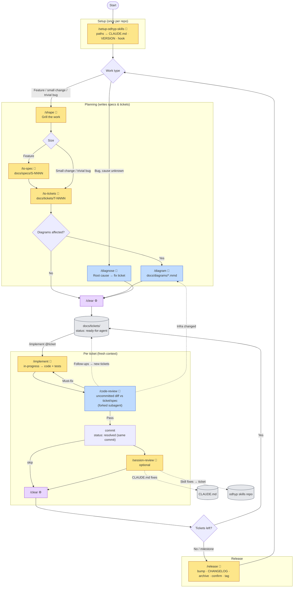

# odhyp skills

My engineering workflow as agent skills: no project starts from zero.

**Tickets are the handoff between fresh contexts.** Planning, diagnosing and reviewing write tickets. Only `implement` writes code. Run `/clear` between tickets.

## Install

Claude Code (plugin, commands appear as `/odhyp:<skill>`):

```
/plugin marketplace add odhyp/skills
/plugin install odhyp@odhyp
```

Other agents, or an editable copy:

```
npx skills@latest add odhyp/skills
```

## Workflow



👤 manual skill · 🤖 auto skill (you can also call it) · ⚙️ built-in Claude Code command

## Skills

| Skill | Invocation | Does |
|---|---|---|
| `setup-odhyp-skills` | Manual | Run once per repo. Sets up structure, CLAUDE.md block, VERSION, CHANGELOG, commit hook, test/lint commands. On an existing repo, also draws the initial diagrams. Optionally starts from one of the starters. |
| `shape` | Manual | Entry point for features, small changes and trivial bugs. Grills you until we agree, then names the next step. Writes nothing. |
| `to-spec` | Manual | Turns the agreed conversation into `docs/specs/NNNN-slug.md`. |
| `to-tickets` | Manual | Splits a spec, or an agreed small change with no spec, into self-contained tickets in `docs/tickets/`. |
| `diagnose` | Auto | Triggers when you report a bug whose cause is unknown. Never triggers on failures in work that's in progress. Reproduces the bug, finds the root cause, then writes a `fix` ticket. **Does not fix.** |
| `diagram` | Auto | Creates or updates `docs/diagrams/*.mmd`. Triggers only when a change adds, removes or rewires services, infrastructure, data flow or module boundaries. |
| `implement` | Manual | `/implement @docs/tickets/NNNN-slug.md`: builds one ticket test-first, runs `code-review`, then commits. The only skill that writes code. |
| `code-review` | Auto | Runs after `implement` finishes and **before it commits**, in a forked subagent (`context: fork`). Reviews the uncommitted diff against the ticket, or the spec, or the request. Returns must-fix findings to `implement` and writes follow-up tickets. |
| `release` | Manual | Computes the SemVer bump from resolved tickets and commits, updates VERSION and CHANGELOG, archives, and tags after you confirm. |
| `session-review` | Manual | Run before `/clear`. Reviews *this session* and suggests improvements to the agent's environment. |

Manual skills have side effects or run when you decide. Auto skills start when their trigger condition is met.

Run `/setup-odhyp-skills` first in each project: it copies the ticket and spec formats into the project, so every other skill (and every agent) reads them from there.

## Development

- `sh tests/commit-msg.test.sh` checks the commit hook template.
- `claude plugin validate .` checks the manifests and skills.
- The full design is in [ODHYP-SKILLS-HANDOFF.md](ODHYP-SKILLS-HANDOFF.md).

## Versioning

SemVer, Conventional Commits, [CHANGELOG](CHANGELOG.md). Each release bumps `version` in both `.claude-plugin/plugin.json` and `.claude-plugin/marketplace.json` (clients only update when it increases), and in `VERSION`.

## License

[MIT](LICENSE)
