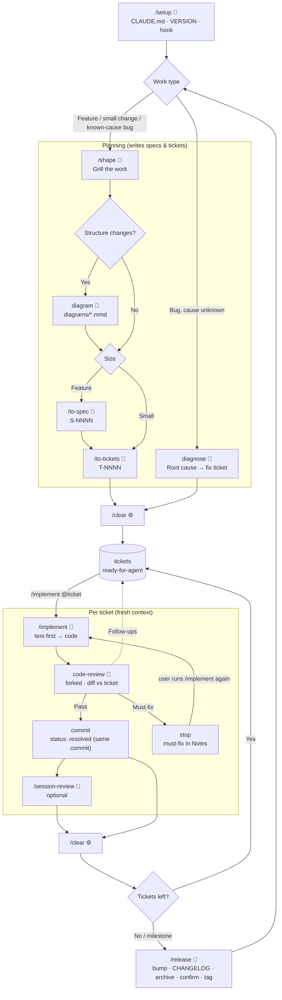

# odhyp skills

My engineering workflow as Claude Code skills, installed once and used in every project.

**Tickets are the handoff between fresh contexts.** Planning, diagnosing and reviewing write tickets. Only `implement` writes code. Run `/clear` between tickets.

## Install

Globally, as a Claude Code plugin (commands appear as `/odhyp:<skill>`):

```
/plugin marketplace add odhyp/skills
/plugin install odhyp@odhyp
```

Then run `/odhyp:setup` once in each project that uses the workflow. The skills read their templates from the plugin, so plugin install is the only supported method ([ADR 0003](docs/adr/0003-shared-templates-plugin-only.md)).

## Workflow



👤 manual skill · 🤖 auto skill (starts on its own; you can also call it) · ⚙️ built-in Claude Code command

## Skills

| Skill            | Invocation | Does                                                                                                                                                                         |
| ---------------- | ---------- | ---------------------------------------------------------------------------------------------------------------------------------------------------------------------------- |
| `setup`          | Manual     | Run once per project. Writes the CLAUDE.md block (paths, version files, changelog, commands), VERSION, CHANGELOG, the commit hook and the empty docs folders. Safe to re-run.                            |
| `shape`          | Manual     | Entry point for features, small changes and known-cause bugs. Grills you until you agree, draws diagrams if the structure changes, then names the next step.                 |
| `to-spec`        | Manual     | Turns the agreed design into a spec (`S-NNNN`).                                                                                                                              |
| `to-tickets`     | Manual     | Splits a spec, or an agreed small change, into self-contained tickets (`T-NNNN`).                                                                                            |
| `diagnose`       | Auto       | When you report a bug whose cause is unknown: reproduces it, finds the root cause, writes a `fix` ticket. Does not fix.                                                      |
| `diagram`        | Auto       | Creates or updates the `.mmd` diagrams: on request, from `shape`, or when a change makes an existing diagram wrong.                                                          |
| `implement`      | Manual     | `/odhyp:implement @<ticket>`: builds one ticket test-first, runs `code-review`, then commits on a pass or stops with the must-fix findings. The only skill that writes code. |
| `code-review`    | Auto       | Reviews the uncommitted diff against the ticket in a forked subagent, before the commit. Writes follow-up tickets. Also reviews a ticket's commits on request.               |
| `release`        | Manual     | Computes the SemVer bump, updates the version and CHANGELOG, archives tickets and specs, then commits and tags after you confirm.                                            |
| `session-review` | Manual     | Run before `/clear`: reviews the session and proposes fixes to CLAUDE.md and to these skills.                                                                                |

## Polaris contract

Polaris (`npx -y @odhyp/polaris@2`) is the view across all projects. The skills have no runtime dependency on it; they only produce what it reads, defined once in [`plugins/odhyp/templates/`](plugins/odhyp/templates/):

- The odhyp block in each project's `CLAUDE.md`: one line each for `Specs:`, `Tickets:`, `Diagrams:`, `Releases:`, `Version files:` and `Changelog:`. Polaris keeps its own config in its app data, not in the repo.
- Ticket and spec files with the locked frontmatter in `TICKET-FORMAT.md` and `SPEC-FORMAT.md`. Changing a field is a breaking change for both repos.
- `.mmd` diagrams, each opening with a `%%` header comment.
- The version file and CHANGELOG.

### Using your own skills

Polaris doesn't need odhyp. What it reads is the ticket and spec format, so any skills that write files following [`TICKET-FORMAT.md`](plugins/odhyp/templates/TICKET-FORMAT.md) and [`SPEC-FORMAT.md`](plugins/odhyp/templates/SPEC-FORMAT.md) show up in Polaris too. odhyp has no runtime dependency on Polaris: Polaris only reads, and it keeps its own config in its app data, outside the repo.

## Roadmap

- **v0.1.0:** try the workflow end to end in a throwaway project from global install (setup → shape → spec → tickets → implement → review → release), then tag this repo `v0.1.0`.
- **Later:** a frontmatter and link validation check; avoiding ticket ID collisions across parallel branches; `context: fork` for `implement`; a ticket overview in Polaris.

## Development

- `sh tests/commit-msg.test.sh` checks the commit hook template.
- `claude plugin validate .` checks the marketplace; `claude plugin validate plugins/odhyp` checks the plugin and its skills.
- Decisions and their reasons: [`docs/adr/`](docs/adr/). Vocabulary: [`GLOSSARY.md`](GLOSSARY.md).
- Layout: the plugin lives in `plugins/odhyp/` (skills, templates, `plugin.json`); the root holds the marketplace and this repo's own dev files, which installs never receive.
- Releases bump `version` in `VERSION` and `plugins/odhyp/.claude-plugin/plugin.json` together; clients only update when it increases. The marketplace entry carries no version, since `plugin.json` wins.
- `sh tests/review-smoke.sh` runs the plugin headless in a throwaway repo and checks that `code-review` forks and catches a planted bug. It calls the API (about $0.35), so it runs by hand, not in CI.
- CI (`.github/workflows/ci.yml`) runs the hook test and both validations on every push and pull request, except ones that only touch docs (`README.md`, `docs/**` and the other paths listed in the workflow).

## Feedback

- Bugs, questions and ideas: [Discussions](https://github.com/odhyp/skills/discussions). Bug reports go in Q&A, which has a form.
- This repo doesn't use GitHub Issues. Work is tracked as ticket files in [`docs/tickets/`](docs/tickets/), and good ideas from Discussions become tickets there.
- Pull requests are open to collaborators only. To propose a change, start a discussion.
- Security problems: report them privately, as [`SECURITY.md`](SECURITY.md) describes, not in Discussions.
- More in [`CONTRIBUTING.md`](CONTRIBUTING.md) and the [Code of Conduct](CODE_OF_CONDUCT.md).

## License

[MIT](LICENSE)
