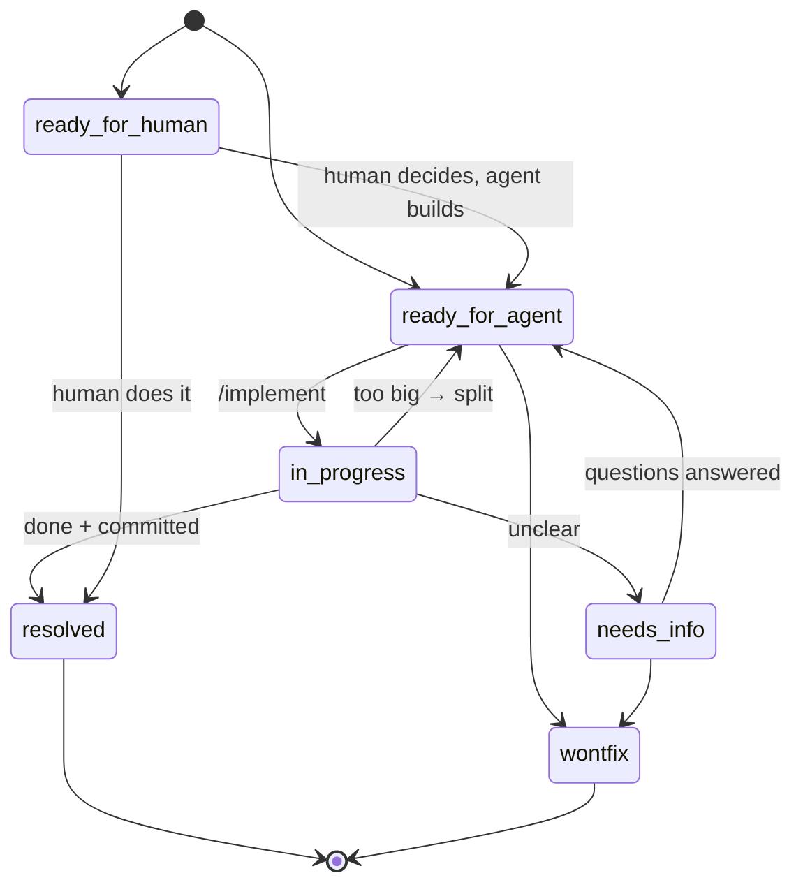

# Ticket format

This format is the contract any skills can write to so that Polaris can read their output.

A ticket is the handoff between fresh contexts. A fresh agent must be able to finish it from the ticket alone; the spec is background reading only.

**The frontmatter is locked:** exactly the fields below, in this order, and no skill adds its own. Polaris parses it, so changing it is a breaking change for both repos. The body is free Markdown; the sections under Body are the recommended structure. Blank template: `ticket.md`.

- **One file per ticket**, flat in the tickets folder (path in the odhyp block in `CLAUDE.md`): `NNNN-short-slug.md` (e.g. `0018-dashboard-layout.md`).
- **Link by ID, never by path**, so archiving into `releases/` breaks nothing.
- **Size:** one ticket fits one fresh session. Bigger → split.

## IDs

`T-NNNN`, zero-padded, never reused. The next ID is the highest existing `T-` ID in the tickets folder and in the releases archive, plus one; the first is `T-0001`. Specs count separately (`S-NNNN`).

## Frontmatter

```yaml
---
id: T-0018
title: Dashboard layout
type: feat                # see Types
breaking: false
scope: dashboard          # commit scope, lowercase-kebab
status: ready-for-agent   # see Statuses
spec: S-0005              # or none
depends_on: [T-0017]      # or []
source: to-tickets        # to-tickets | diagnose | code-review | implement | session-review | human
parent: none              # ticket this was split from or follows up, or none
diagrams: [architecture]  # diagram files this changes (no extension), or []
released_in:              # set by /release
---
```

No dates (git has them), no assignee (status covers it), no priority.

## Types

Identical to commit types.

| type | SemVer bump |
|---|---|
| `feat` | minor |
| `fix`, `perf` | patch |
| `refactor`, `test`, `docs`, `build`, `ci`, `chore`, `style` | none |

`breaking: true` means a major bump for any type. Before 1.0.0, breaking bumps the minor version.

## Statuses

| status | Meaning | Set by |
|---|---|---|
| `ready-for-agent` | Fully specified; an agent can do it | to-tickets, diagnose, human |
| `ready-for-human` | Needs a person (credentials, DNS, design call, manual test) | any skill, human |
| `needs-info` | Blocked on the questions in `## Questions`; back to `ready-for-agent` once all are answered | implement (sets and clears), human or Polaris (clears) |
| `in-progress` | An agent is working on it (crash recovery) | implement |
| `resolved` | Code and tests committed | implement, in the same commit as the code |
| `wontfix` | Dropped (incl. duplicates); reason in `## Notes` | human |

Dependencies are not a status: `implement` refuses to start until every `depends_on` ticket is `resolved`.



## Body

```markdown
## Context
What and why, readable without the spec.

## Decisions that apply
Choices copied from the spec that this ticket must follow.

## Files
- path (new | change)

## Acceptance criteria
- [ ] …

## Out of scope
What NOT to build here.

## Questions
<!-- only when needs-info; the human answers inline -->

## Notes
<!-- implement appends what it did; wontfix reason; post-commit review findings -->
```

**`fix` tickets from `diagnose`** add four sections right after `## Context`: `## Reproduction`, `## Expected / Actual`, `## Root cause`, `## Failing test to write first`.
**Trivial-bug `fix` tickets** (cause already known, from `to-tickets`) skip those four and state the cause in one line in `## Context`.

## Example: `feat`

```markdown
---
id: T-0018
title: Dashboard layout
type: feat
breaking: false
scope: dashboard
status: ready-for-agent
spec: S-0005
depends_on: [T-0017]
source: to-tickets
parent: none
diagrams: [architecture]
released_in:
---

## Context
Logged-in users land on an empty page. S-0005 adds a dashboard; this ticket builds
only its layout shell: a header, a sidebar with nav links, and a main area that
renders a placeholder card. Widgets come in T-0019.

## Decisions that apply
- Layout uses CSS grid, no layout library.
- Sidebar collapses below 768px into a top menu button.
- The route is `/dashboard`; `/` redirects there when logged in (T-0017 added the auth check).

## Files
- src/dashboard/layout.html (new)
- src/dashboard/layout.css (new)
- src/routes.py (change)
- tests/test_dashboard_layout.py (new)

## Acceptance criteria
- [ ] GET /dashboard while logged in returns 200 with header, sidebar and main area.
- [ ] GET / while logged in redirects to /dashboard.
- [ ] Below 768px the sidebar is hidden and a menu button is shown.
- [ ] architecture.mmd shows the dashboard module and its dependency on auth.

## Out of scope
- Widgets and real data (T-0019).
- User settings link target.

## Questions

## Notes
```

## Example: `fix` (from `diagnose`)

```markdown
---
id: T-0023
title: Export drops rows with a comma in the name
type: fix
breaking: false
scope: export
status: ready-for-agent
spec: none
depends_on: []
source: diagnose
parent: none
diagrams: []
released_in:
---

## Context
CSV export silently loses customers whose name contains a comma. Reported with
"Acme, Inc." missing from a 40-row export.

## Reproduction
1. Create a customer named `Acme, Inc.`.
2. Run `python -m app export customers out.csv`.
3. `grep -c Acme out.csv` → 0.

## Expected / Actual
- Expected: the row is present, with the name quoted: `"Acme, Inc."`.
- Actual: the row is missing; no error is logged.

## Root cause
`export.write_rows` joins fields with `",".join(...)` instead of using `csv.writer`.
The importer used for the round-trip check then sees too many columns and
`skip_bad_rows=True` drops the row without logging.

## Failing test to write first
`tests/test_export.py::test_name_with_comma_round_trips`: export one customer
named `Acme, Inc.`, read it back with `csv.reader`, assert the name is unchanged.

## Decisions that apply
- Use the stdlib `csv` module; no new dependency.
- Leave `skip_bad_rows` as is; it is used elsewhere.

## Files
- app/export.py (change)
- tests/test_export.py (change)

## Acceptance criteria
- [ ] The failing test above passes.
- [ ] Names with commas, quotes and newlines all round-trip.

## Out of scope
- Logging dropped rows in the importer (separate ticket if wanted).

## Questions

## Notes
```
